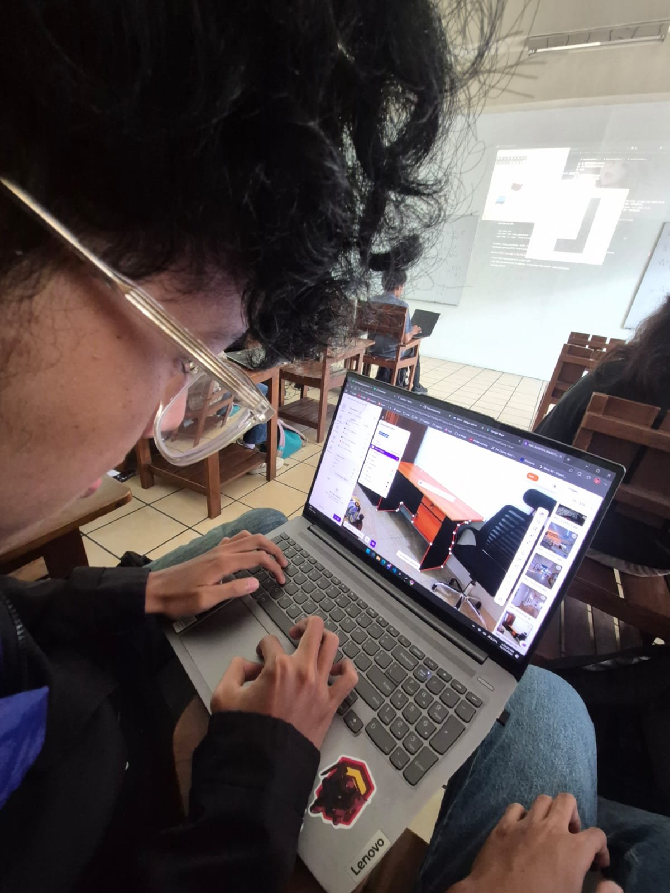
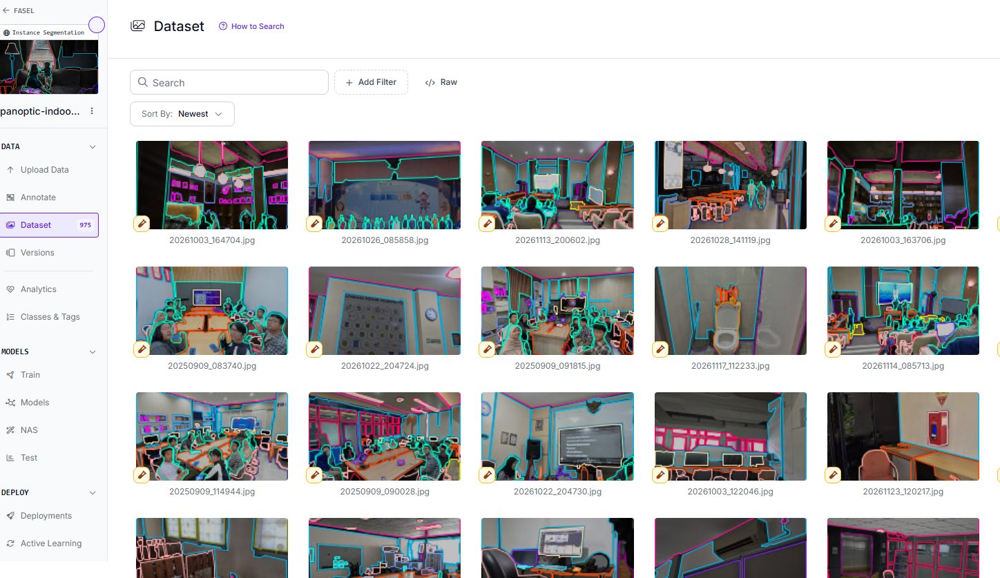
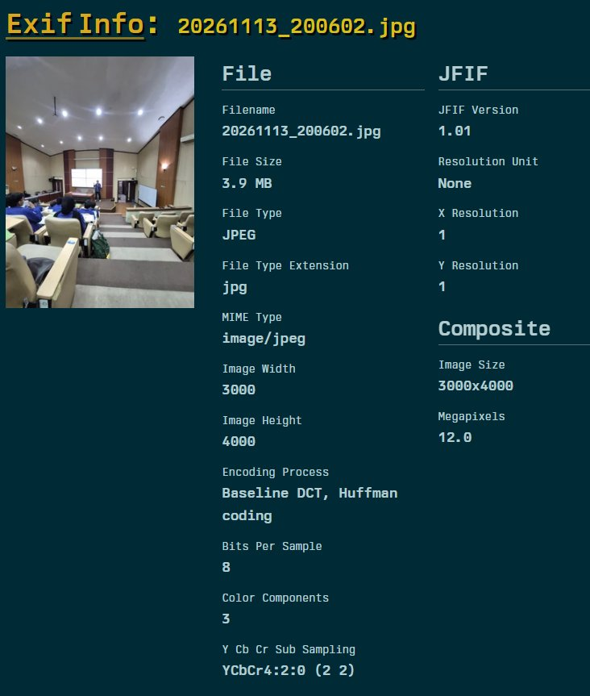
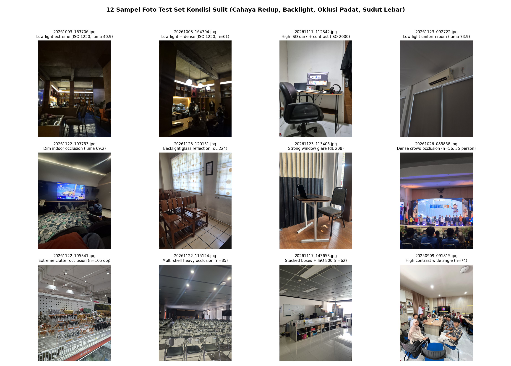
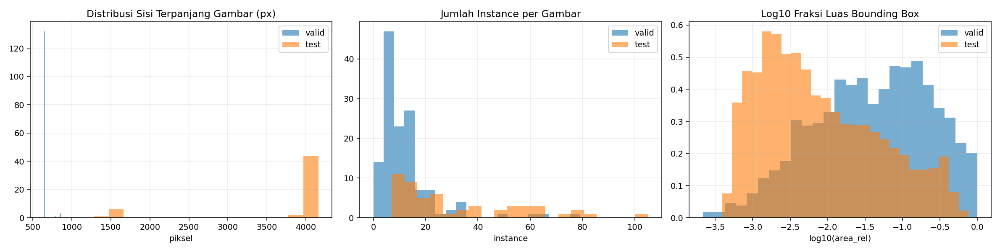
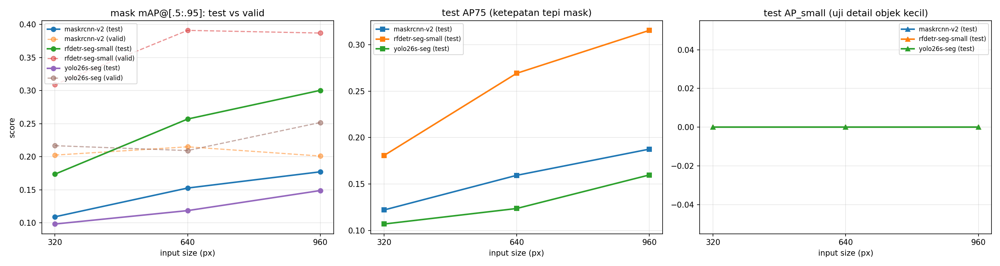
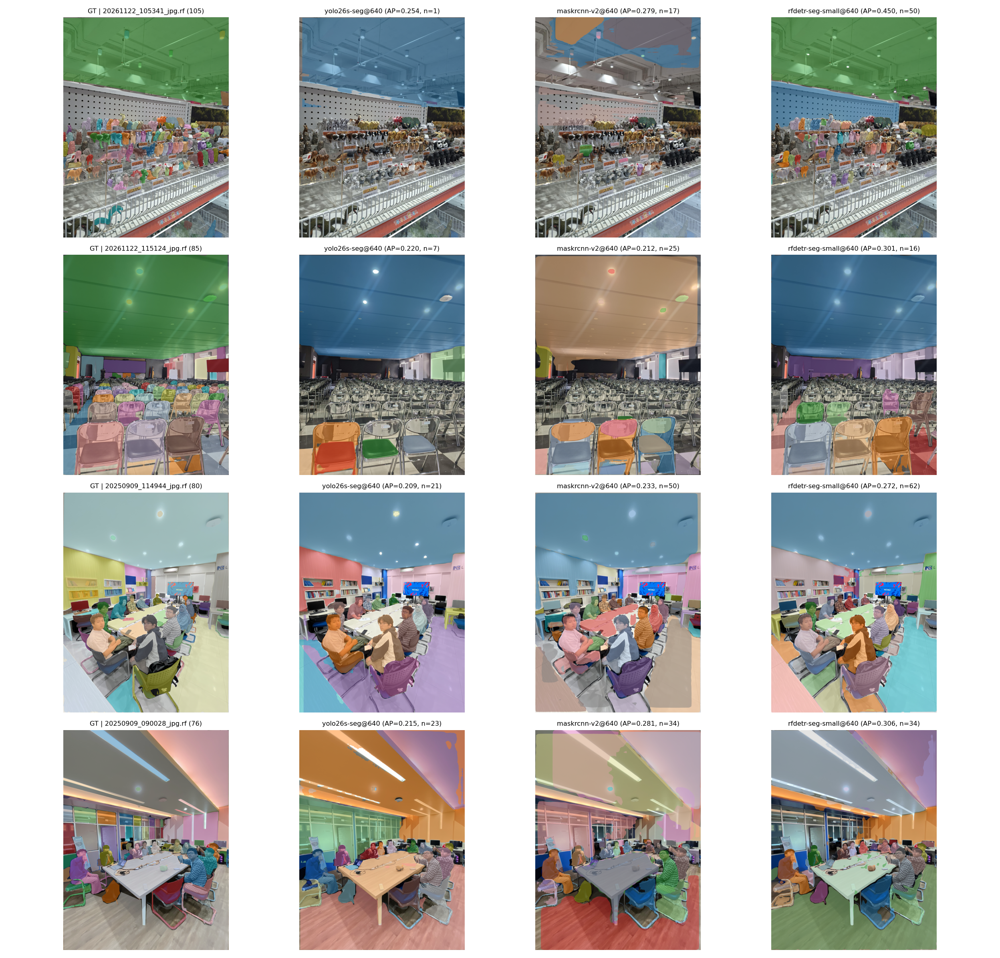
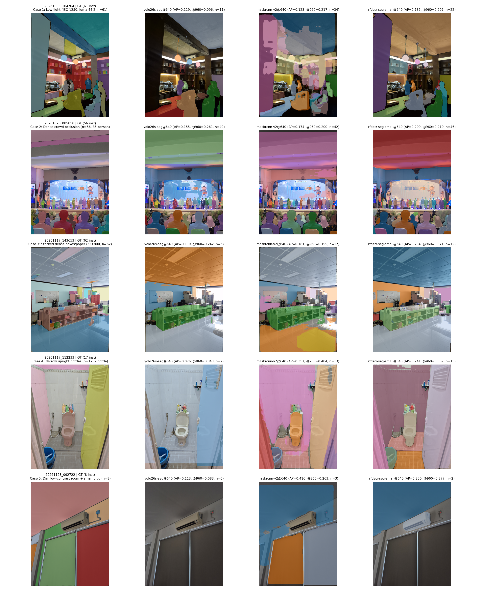
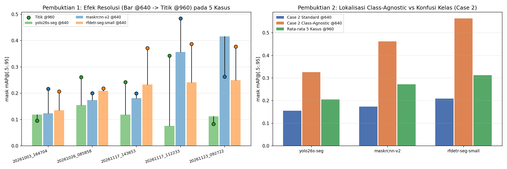
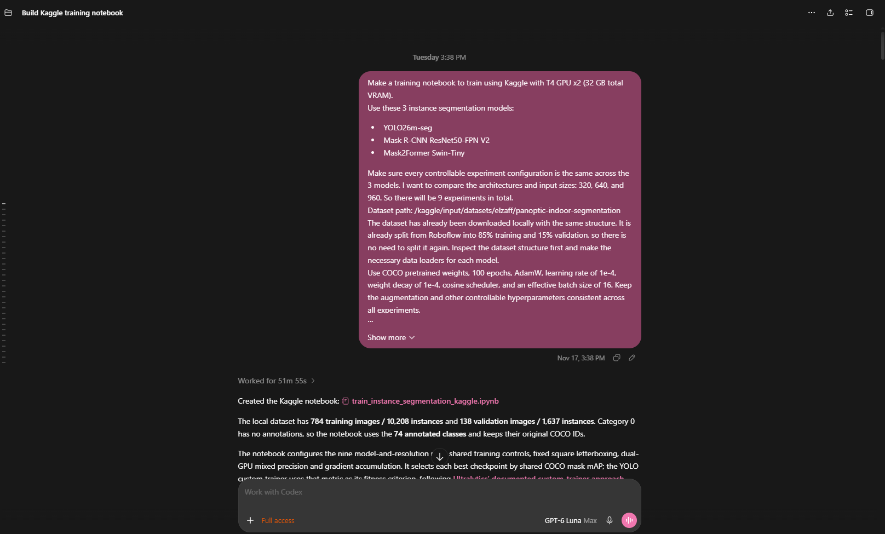

# Segmentasi Instance pada Lingkungan Indoor Nyata

Repositori ini berisi kode, log training, dan hasil evaluasi untuk tugas **Segmentasi Instance (Evaluasi CPMK 3)** mata kuliah Visi Komputer di Institut Teknologi Sepuluh Nopember (ITS). Eksperimen menguji pengaruh **ukuran input (`320`, `640`, dan `960` piksel)** sesuai digit akhir NRP `0` (`5054241020`) pada tiga keluarga arsitektur berbeda, lalu mengevaluasi penurunan performa (*domain shift*) terhadap *test set* ruangan nyata hasil foto pribadi.

- **Repositori GitHub:** <https://github.com/elzaff/instance-segmentation-tugas-viskom>
- **Dataset Final di Roboflow (`Version 2 - dataset final fazle`):** <https://app.roboflow.com/fasel/panoptic-indoor-segmentation-zsgy2/2>
- **Dataset Latih Asli (`Panoptic Indoor Segmentation`):** <https://universe.roboflow.com/panopticindoor/panoptic-indoor-segmentation>
- **Checkpoint Model & Output di Google Drive:** <https://drive.google.com/drive/folders/1Tfi6Vm-9aMsdQhSEosD6rBaxVs6SgtAc?usp=sharing>

---

## 1. Profil Tugas & Ruang Lingkup Eksperimen

| Nama | Fazle Mawla Wahyuhanda |
| --- | --- |
| NRP | `5054241020` |
| Kelas | RKA |
| Variabel Eksperimen (NRP akhir `0`) | Ukuran input (`320`, `640`, dan `960` piksel) |
| Model yang Dibandingkan | `YOLO26s-seg` (one-stage CNN) `Mask R-CNN R50-FPN v2` (two-stage CNN) `RF-DETR-Seg Small` (transformer DETR pada `312`, `648`, `960` piksel) |
| Total Konfigurasi | `9` eksperimen (`3 arsitektur x 3 ukuran input`, `seed = 42`) |
| Kelas Aktif | `74` kelas pelatihan (`46` kelas muncul pada `1.715` anotasi *test*) |

Pada model `RF-DETR-Seg Small`, arsitektur backbone `DINOv2` dan proyektornya mewajibkan dimensi input berupa kelipatan `24`. Target ukuran `320` dan `640` disesuaikan ke kelipatan `24` terdekat (`312 = 13 x 24` dan `648 = 27 x 24`), sementara `960` (`40 x 24`) tetap sama.

---

## 2. Dataset Acuan vs *Test Set* Mandiri (Samsung Galaxy S24 FE)

Seluruh model dilatih pada split `train` (`784` gambar sebelum sanitasi) dan diuji pada split `valid` bawaan dataset (`136` gambar aktif setelah `2` gambar yang dimensi anotasinya tidak cocok dengan orientasi EXIF dibuang). Untuk *test set* mandiri, sebanyak **53 foto ruangan nyata** diambil menggunakan kamera HP **Samsung Galaxy S24 FE (`Galaxy S24 FE` / `SM-S721B`)** di ruang kos, ruang kelas ITS, dan koridor kampus, kemudian dianotasi di Roboflow (`Dataset Version 2: dataset final fazle`) mengikuti daftar `74` kelas yang sama.

### Ringkasan Split `valid` vs `test`

| Metrik Dataset | Split `valid` (Asli) | Split `test` (Foto Pribadi S24 FE) |
| --- | --- | --- |
| Jumlah Gambar (Pasca-Sanitasi) | `136` | `53` |
| Total Anotasi *Instance* | `~1.618` | `1.715` |
| Sisi Terpanjang Rata-Rata | `645.8 px` (`640 - 857 px`) | `3677.0 px` (`1280 - 4160 px`, median `4000.0 px`) |
| Jumlah Instance per Gambar | Rata-rata `11.9` (median `9.0`, maks `79`) | Rata-rata `32.4` (median `23.0`, maks `105`) |
| Proporsi Skala COCO (`small` / `medium` / `large`) | `9.52%` / `33.77%` / `56.71%` | `0.06%` / `8.45%` / `91.49%` |

Dari `53` foto *test*, sebanyak **30 foto** masuk kategori kondisi sulit (rincian tiap foto tercatat di [`results/test/hard_conditions_summary.csv`](results/test/hard_conditions_summary.csv)):

- **Cahaya redup & High-ISO:** ruangan minim lampu dengan nilai `ISO` mencapai `1250 - 2000` dan rata-rata luminansi gelap `40.9 - 44.2` (`20261003_163706.jpg`, `20261003_164704.jpg`, `20261117_112342.jpg`).
- **Backlight & kontras tinggi:** rentang intensitas `p95 - p5` sebesar `204 - 242` akibat cahaya kuat dari jendela dan pantulan kaca (`20260501_104424.jpg`, `20261123_120151.jpg`, `20261123_113405.jpg`).
- **Oklusi padat & sudut lebar:** foto kerumunan orang dan rak penuh barang berisi `51 - 105` objek dalam satu gambar (`20261122_105341.jpg` memuat `105` instance, `20261122_115124.jpg` memuat `85` kursi).

### Bukti Proses Anotasi, Dataset Roboflow v2, dan Metadata EXIF

| Bukti Foto Anotasi di Roboflow | Dataset Roboflow Versi 2 (`975` gambar) |
|---|---|
|  |  |

---

## 3. Hipotesis Awal (Sebelum Training Pertama)

Hipotesis berikut dicatat di [`logbook.docx`](logbook.docx) pada **14 November 2026** sebelum eksperimen pelatihan pertama berjalan:

1. **`RF-DETR-Seg Small` diperkirakan meraih skor *mask mAP* tertinggi.** Backbone transformer (`DINOv2`) dengan *global attention* lebih mampu membedakan objek yang saling bertumpuk dibandingkan `Mask R-CNN v2` maupun `YOLO26s-seg`.
2. **Kecepatan vs presisi batas:** `YOLO26s-seg` diprediksi unggul dari sisi kecepatan inferensi, tetapi detail pinggiran objeknya turun pada ukuran input kecil karena *prototype mask* hanya memakai resolusi seperempat input. `Mask R-CNN v2` diperkirakan cukup stabil pada objek sedang dan besar, tetapi tertahan oleh *grid* `28x28` di *mask head* ketika menghadapi objek sempit.
3. **Pengaruh *image size* dan kelas:** Menaikkan ukuran input (`320 -> 640 -> 960 px`) akan mengangkat akurasi secara nyata terutama pada foto *test* asli yang berukuran `3000 x 4000 px`. Kelas berfrekuensi tinggi (`person`, `chair`, `tv`, `table-merged`) diperkirakan paling mudah dikenali, sedangkan kelas langka (`plug`, `book`, `paper-merged`, variasi jenis dinding) paling rentan salah.

---

## 4. Hasil Evaluasi, *Domain Shift*, dan Waktu GPU

Seluruh model dievaluasi dengan metrik standar COCO `segm` (`pycocotools`, `max_det = 100`) melalui notebook [`notebooks/02_eval_inference_instance_segmentation_colab.ipynb`](notebooks/02_eval_inference_instance_segmentation_colab.ipynb) di GPU **NVIDIA L4 (23 GB VRAM)** menggunakan bobot hasil pelatihan pada **NVIDIA A100-SXM4-40GB** ([`notebooks/01_train_instance_segmentation_colab.ipynb`](notebooks/01_train_instance_segmentation_colab.ipynb)).

### Tabel Hasil Lengkap (`valid` vs `test`)

| Model | Target Size (Actual) | `valid` mAP | `valid` AP50 | `test` mAP | `test` AP50 | `test` AP75 | `test` AR100 | Domain Shift (`test - valid`) | Waktu Uji (`s/img`) |
| --- | --- | ---: | ---: | ---: | ---: | ---: | ---: | ---: | ---: |
| `yolo26s-seg` | 320 (320) | 0.2168 | 0.3104 | 0.0983 | 0.1651 | 0.1068 | 0.1705 | -0.1185 | 3.970 |
| `yolo26s-seg` | 640 (640) | 0.2094 | 0.3004 | 0.1186 | 0.1700 | 0.1236 | 0.2008 | -0.0908 | 4.986 |
| `yolo26s-seg` | 960 (960) | 0.2518 | 0.3472 | 0.1489 | 0.2159 | 0.1597 | 0.2547 | -0.1029 | 3.507 |
| `maskrcnn-v2` | 320 (320) | 0.2026 | 0.3036 | 0.1092 | 0.1685 | 0.1220 | 0.1941 | -0.0933 | 5.061 |
| `maskrcnn-v2` | 640 (640) | 0.2151 | 0.3307 | 0.1527 | 0.2203 | 0.1593 | 0.2783 | -0.0624 | 4.303 |
| `maskrcnn-v2` | 960 (960) | 0.2011 | 0.3057 | 0.1773 | 0.2485 | 0.1875 | 0.3077 | **-0.0239** | 3.014 |
| `rfdetr-seg-small` | 320 (312) | 0.3093 | 0.4204 | 0.1737 | 0.2517 | 0.1807 | 0.2620 | -0.1356 | 4.103 |
| `rfdetr-seg-small` | 640 (648) | **0.3912** | **0.4934** | 0.2571 | 0.3348 | 0.2693 | 0.3693 | -0.1341 | 6.061 |
| `rfdetr-seg-small` | 960 (960) | 0.3872 | 0.4903 | **0.3005** | **0.3874** | **0.3155** | **0.4343** | -0.0867 | **2.703** |

*Catatan waktu: angka `s/img` pada split `test` sudah mencakup pembacaan file gambar `3000 x 4000 px`, inferensi GPU, pengubahan ukuran masker ke resolusi asli, dan pengodean COCO RLE (`max_det = 100`). Di split `valid` (`~640 px`), kecepatan inferensi bersih berada di kisaran `0.091 - 0.158 s/img` (`6.3 - 11.0 fps`).*

### Temuan Utama & Pencocokan Hipotesis

1. **Perbandingan Arsitektur:** `RF-DETR-Seg Small` menduduki posisi puncak di seluruh ukuran input. Pada `test`, `rfdetr-seg-small@960` meraih `mask_mAP = 0.3005`, unggul `0.1232` di atas `maskrcnn-v2@960` (`0.1773`) dan `0.1516` di atas `yolo26s-seg@960` (`0.1489`). Hasil ini sesuai dengan **Hipotesis 1**.
2. **Efek Ukuran Input (`320` vs `640` vs `960`):**
   - Di split `valid` yang memang beresolusi ~`640 px`, membesarkan input ke `960 px` sedikit menurunkan skor `RF-DETR` (`0.3912 -> 0.3872`) dan `Mask R-CNN` (`0.2151 -> 0.2011`) karena gambar hanya diperbesar lewat interpolasi tanpa tambahan detail baru.
   - Di split `test` yang beresolusi asli `3000 x 4000 px`, kenaikan `640 -> 960 px` justru mengangkat skor **seluruh model tanpa kecuali**: `RF-DETR` naik `+0.0434`, `YOLO26s-seg` naik `+0.0303`, dan `Mask R-CNN v2` naik `+0.0246`. Skor `AP_medium` `RF-DETR` melonjak hampir dua kali lipat dari `0.1003` (`640 px`) menjadi `0.1873` (`960 px`), membuktikan **Hipotesis 3**.
3. **Analisis *Domain Shift* (`test - valid`):** Semua model mengalami penurunan skor saat diuji ke foto ruangan nyata Indonesia. Penurunan terbesar di `640 px` terjadi pada `RF-DETR` (`-0.1341`) karena kepadatan objek di `test` hampir tiga kali lipat `valid` (`32.4` vs `11.9` instance per gambar), ditambah banyaknya foto minim cahaya dan perbedaan desain ruangan lokal. Di resolusi `960 px`, `Mask R-CNN v2` mencatat *domain shift* terkecil (`-0.0239`).
4. **Konsumsi Waktu GPU (`results/valid/gpu_hours.csv`):** Total waktu pelatihan `9` run di Google Colab Pro **NVIDIA A100-SXM4-40GB** adalah **`3.29 GPU-jam`**, terbagi ke `YOLO26s-seg` (`0.80 jam`), `Mask R-CNN v2` (`0.83 jam`), dan `RF-DETR-Seg Small` (`1.86 jam`).

### Performa Per Kelas (`rfdetr-seg-small@960` di `test`)

Ringkasan lengkap `46` kelas aktif tersimpan di [`results/test/per_class_test_rfdetr-seg-small_960.csv`](results/test/per_class_test_rfdetr-seg-small_960.csv):

- **Kelas dengan mAP tertinggi (minimal `10` instance):** `laptop` (`0.6464`, `n=19`), `person` (`0.6314`, `n=181`), `cup` (`0.5787`, `n=12`), `ceiling-merged` (`0.5581`, `n=59`), `floor-other-merged` (`0.5578`, `n=69`), `tv` (`0.5099`, `n=65`), `bottle` (`0.4199`, `n=34`), dan `chair` (`0.3149`, `n=305`).
- **Kelas dengan mAP terendah:** objek kecil atau minim perbedaan tekstur seperti `wall-wood` (`0.0075`, `n=27`), `paper-merged` (`0.0050`, `n=20`), `book` (`0.0715`, `n=42`), dan `plug` (`0.0789`, `n=15`), serta kelas dengan kemunculan sangat jarang (`counter`, `microwave`, `towel`, `food-other-merged` `0.0000`). Pola ini konsisten dengan perkiraan awal di **Hipotesis 3**.

---

## 5. Analisis Kegagalan Berbasis Bukti (5 Foto `test`) & Eksperimen Pembuktian

Lima gambar dari *test set* dipilih untuk membedah penyebab kegagalan model serta hubungannya dengan mekanisme arsitektur masing-masing.

| Kasus & Nama File | Kondisi Foto | Kegagalan Utama yang Teramati | Penjelasan Mekanisme Model |
| --- | --- | --- | --- |
| **Case 1** `20261003_164704.jpg` | Kafe redup (`ISO 1250`, `luma 44.2`, `61` objek, `24 book`) | Seluruh `24/24 book` gagal terdeteksi oleh YOLO dan RF-DETR (`conf>=0.25`); Mask R-CNN salah mengklasifikasikan `book` sebagai `toy` (`IoU 0.92`) dan `light` sebagai `ceiling-merged` (`IoU 0.87`). | Noise tinggi pada `ISO 1250` mengaburkan tekstur tepi buku di rak gelap. Pada Mask R-CNN, RPN masih bisa menangkap proposal kotak rak, tetapi fitur `RoIAlign` yang gelap membuat klasifier salah menebak label. |
| **Case 2** `20261026_085858.jpg` | Kerumunan ruang auditorium (`56` objek: `35 person`, `7 chair`) | Banyak `person` terpotong atau tertukar label dengan `chair` (`person -> chair IoU 0.89` di YOLO). | NMS berbasis *bounding box* pada YOLO dan Mask R-CNN menekan kotak orang yang bertumpuk rapat di barisan belakang. Pada RF-DETR, *object query* saling tumpang tindih merebut area tubuh yang sama. |
| **Case 3** `20261117_143653.jpg` | Rak padat berderet (`ISO 800`, `62` objek: `20 box`, `9 paper-merged`) | Di `640 px`, YOLO melewatkan `20/20 box` dan `9/9 paper-merged`; `door-stuff` kerap tertukar dengan `cabinet-merged` (`IoU 0.90`). | *Prototype mask* YOLO (`160x160` di input `640`) dan grid Mask R-CNN `28x28` terlalu kasar untuk menjaga batas antar-kardus kecil yang menempel satu sama lain. |
| **Case 4** `20261117_112233.jpg` | Kamar mandi, `9 bottle` berjajar vertikal (`17` objek) | YOLO `@640` melewatkan `9/9 bottle` (`mAP=0.076`, turun menjadi `0.000` pada `conf>=0.35`); `wall-other-merged` tertukar dengan `wall-tile` (`IoU 0.75`). | Objek tinggi-sempit jatuh pada lebar kurang dari `1 - 2` sel fitur di *stride* `16/32`, sehingga *prototype mask* YOLO pada `640 px` gagal membentuk potongan botol terpisah. |
| **Case 5** `20261123_092722.jpg` | Dinding redup minim tekstur, terdapat AC & `plug` kecil (`8` objek) | Objek `plug` gagal dideteksi seluruh model (`0/1`); masker `window-blind` di Mask R-CNN bocor dan salah terklasifikasi sebagai `door-stuff` (`IoU 0.92`) maupun `wall-other-merged` (`IoU 0.97`). | Kurangnya kontras batas menyebabkan *mask leakage* pada kepala konvolusi `28x28` saat di-*upsample* ke `4000 px`. Selain itu, unit AC pada dinding atas bukan termasuk `74` kelas latih sehingga memicu kebingungan fitur lokal di sekitarnya. |

### Eksperimen Pembuktian Kuantitatif (`results/test/failure_ablation_5cases.csv`)

Penjelasan di atas diuji lewat tiga percobaan kuantitatif pada hasil prediksi asli kelima gambar tersebut: (1) pembandingan langsung resolusi `320 -> 640 -> 960 px`, (2) evaluasi *class-agnostic* (menyatukan seluruh kategori menjadi satu kelas objek) untuk memisahkan error lokasi vs error klasifikasi, dan (3) pengetatan *confidence threshold* ke `0.35`.

| Kasus | Model | `mAP@320` | `mAP@640` | `mAP@960` | `Delta 960-640` | `Class-Agnostic @640` | `conf>=0.35 @640` |
| --- | --- | ---: | ---: | ---: | ---: | ---: | ---: |
| Case 1 (`20261003_164704`) | `yolo26s-seg` | 0.0358 | 0.1189 | 0.0960 | -0.0230 | 0.1200 | 0.0848 |
| Case 1 (`20261003_164704`) | `maskrcnn-v2` | 0.0945 | 0.1233 | **0.2168** | **+0.0934** | 0.1621 | 0.1025 |
| Case 1 (`20261003_164704`) | `rfdetr-seg-small` | 0.1085 | 0.1350 | **0.2066** | **+0.0716** | 0.1555 | 0.1037 |
| Case 2 (`20261026_085858`) | `yolo26s-seg` | 0.1036 | 0.1553 | 0.2614 | +0.1061 | **0.3262** | 0.1285 |
| Case 2 (`20261026_085858`) | `maskrcnn-v2` | 0.1278 | 0.1735 | 0.2000 | +0.0265 | **0.4618** | 0.1606 |
| Case 2 (`20261026_085858`) | `rfdetr-seg-small` | 0.1529 | 0.2093 | 0.2187 | +0.0094 | **0.5630** (`0.5989` @960) | 0.1894 |
| Case 3 (`20261117_143653`) | `yolo26s-seg` | 0.1562 | 0.1185 | **0.2423** | **+0.1238** | 0.1203 | 0.0694 |
| Case 3 (`20261117_143653`) | `maskrcnn-v2` | 0.1652 | 0.1810 | 0.1991 | +0.0182 | 0.1673 | 0.1377 |
| Case 3 (`20261117_143653`) | `rfdetr-seg-small` | 0.1661 | 0.2335 | **0.3714** | **+0.1378** | 0.1457 | 0.1560 |
| Case 4 (`20261117_112233`) | `yolo26s-seg` | 0.0867 | 0.0755 | **0.3426** | **+0.2671** | 0.1266 | **0.0000** |
| Case 4 (`20261117_112233`) | `maskrcnn-v2` | 0.2570 | 0.3566 | **0.4841** | **+0.1275** | 0.2672 | 0.3048 |
| Case 4 (`20261117_112233`) | `rfdetr-seg-small` | 0.1830 | 0.2412 | **0.3871** | **+0.1459** | 0.2557 | 0.1904 |
| Case 5 (`20261123_092722`) | `yolo26s-seg` | 0.0000 | 0.1125 | 0.0833 | -0.0292 | 0.1875 | **0.0000** |
| Case 5 (`20261123_092722`) | `maskrcnn-v2` | 0.3593 | 0.4163 | 0.2625 | -0.1538 | 0.2977 | **0.0000** |
| Case 5 (`20261123_092722`) | `rfdetr-seg-small` | 0.1080 | 0.2500 | **0.3771** | **+0.1271** | 0.1376 | 0.2500 |

**Tiga kesimpulan langsung dari hasil pembuktian:**

1. **Bukti batas resolusi fitur (`640 -> 960`):** Pada Case 3 (tumpukan `box/paper`) dan Case 4 (`bottle` tipis), memperbesar input ke `960 px` langsung menaikkan skor semua model (`YOLO +0.2671` pada Case 4; `RF-DETR +0.1378` pada Case 3 dan `+0.1459` pada Case 4). Objek-objek tersebut sebenarnya bisa disegmentasikan begitu grid fitur cukup rapat.
2. **Bukti salah kelas vs salah lokalisasi (`Class-Agnostic`):** Pada Case 2 (kerumunan), melepas penalti label kelas membuat mAP di `@640` naik `2.1x - 2.7x` (`YOLO: 0.1553 -> 0.3262`, `Mask R-CNN: 0.1735 -> 0.4618`, `RF-DETR: 0.2093 -> 0.5630`). Bentuk maskernya sudah cukup akurat, namun skor turun karena kebingungan kelas antar-objek yang bertumpuk.
3. **Bukti skor keyakinan rendah (`conf >= 0.35`):** Menaikkan ambang menjadi `0.35` membuat skor `YOLO@640` (Case 4 dan 5) dan `Mask R-CNN@640` (Case 5) jatuh tepat ke `0.0000`, menandakan prediksi yang benar pada kondisi redup dan objek tipis keluar dengan *confidence* rendah di bawah `0.35`.

---

## 6. Struktur Repositori & Berkas Proses

- [`logbook.docx`](logbook.docx) : Logbook mingguan (`12/11/2026 - 24/11/2026`) berisi catatan harian progres, hipotesis bertanggal sebelum training pertama, kendala, dan keputusan eksperimen.
- [`notebooks/01_train_instance_segmentation_colab.ipynb`](notebooks/01_train_instance_segmentation_colab.ipynb) : Notebook training terpadu untuk seluruh 9 run di Google Colab A100.
- [`notebooks/02_eval_inference_instance_segmentation_colab.ipynb`](notebooks/02_eval_inference_instance_segmentation_colab.ipynb) : Notebook evaluasi dan inferensi untuk split `valid` dan `test` di Colab L4.
- [`notebooks/kaggle_drafts/`](notebooks/kaggle_drafts/) : Notebook percobaan awal terpisah di Kaggle sebelum migrasi ke Colab Pro.
- [`results/valid/`](results/valid/) : Berkas `final_eval.csv`, `gpu_hours.csv`, `gpu_time.csv`, dan log `results.csv` per epoch beserta manifes `sha256`.
- [`results/test/`](results/test/) : Berkas `test_eval_results.csv`, `per_class_test_rfdetr-seg-small_960.csv`, `hard_conditions_summary.csv`, dan `failure_ablation_5cases.csv`.
- [`configs/handoff_manifest.json`](configs/handoff_manifest.json) : Pemetaan resmi `74` kelas COCO pelatihan dan daftar *checkpoint*.

---

## 7. Deklarasi Penggunaan AI

- **Alat AI yang digunakan:** Codex
- **Cakupan bantuan yang dipakai:** Codex digunakan untuk membantu pembuatan Notebook training dan inference, menganalisa data, menyarankan model, dan membantu dalam debugging.

### Bukti Prompt Awal ke AI

### Kasus Ketidaksetujuan atau Kesalahan AI yang Diperbaiki

- **Penambahan keluarga arsitektur Transformer (`RF-DETR-Seg Small`)**
  - **Kondisi awal:** Asisten AI sempat mengarahkan perbandingan hanya pada dua arsitektur CNN (`one-stage` vs `two-stage`) agar lebih ringan dijalankan di Kaggle.
  - **Perbaikan:** Saya menolak pembatasan tersebut dan meminta menambahkan model berbasis Transformer (`RF-DETR-Seg Small`) supaya eksperimen benar-benar membandingkan tiga paradigma arsitektur berbeda (`YOLO26s-seg`, `Mask R-CNN v2`, dan `RF-DETR-Seg Small`).
